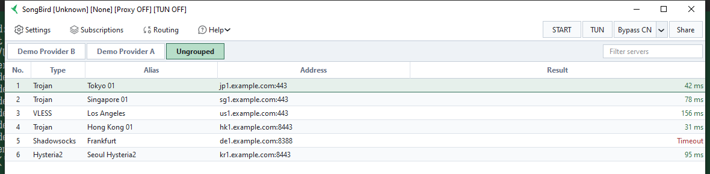
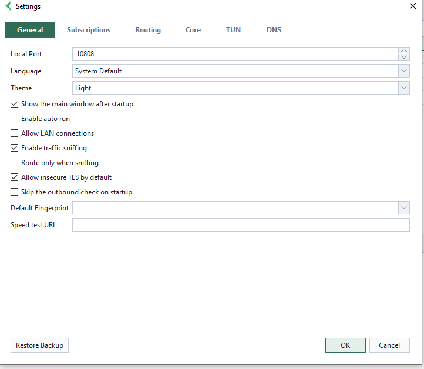

# SongBird

**English** · [简体中文](README_zh_CN.md)

**A lightweight native proxy client for Windows and macOS, written in Qt/C++ — a V2Ray / Xray / sing-box / Mihomo front-end with no Electron, no .NET and no WebView2.**

SongBird manages V2Ray-style proxy servers — VMess, VLESS, Shadowsocks, Trojan, Hysteria2, TUIC, WireGuard, AnyTLS, Naive, SOCKS and HTTP — from a single small desktop application. It imports subscription links, turns the Windows or macOS system proxy on and off, runs server and speed tests, and drives three interchangeable cores: **Xray**, **sing-box** and **Mihomo**.

It is native rather than embedded, so it starts quickly and stays out of the way in the tray. Everything lives in one JSON config file, so backing up or moving to another machine is a file copy. The interface is available in English and Simplified Chinese, in light and dark themes.



Servers are grouped by subscription, and the Result column shows each node's last measurement — a red `Timeout` is as visible as a fast node. The log panel below is where the core's own output goes.

<details>
<summary>Settings</summary>



</details>

## Download

Download the build for your platform from the [latest release](https://github.com/o3ku/SongBird/releases/latest). All three are portable — no installer, no runtime, no registry entry.

| Platform | File |
|---|---|
| Windows | `songbird.exe` |
| Windows, offline | `SongBird-<version>-offline-win-x64.zip` |
| macOS | `SongBird-macos-universal.dmg` |

- The offline zip also contains the sing-box core and its rule-set databases. `songbird.exe` bundles no core, so its first start offers to download one; the zip is for a machine that cannot reach GitHub — unpack it **next to** `SongBird.exe` and everything is already there, still updatable through Settings.
- The macOS DMG is **universal**, so one file runs on both Apple silicon and Intel Macs.
- Both packages are built by CI from the tagged commit. Neither sends telemetry: the only outbound traffic is the proxy itself, plus subscription, core and geodata downloads and a manual update check.

## Features

**Servers and subscriptions**

- Add, edit, delete, reorder and filter servers, grouped by subscription.
- Import servers from the clipboard or from share links; copy a share link and preview its QR code.
- Update subscriptions, and run URL tests and latency (speed) tests.
- Show the outbound location the running proxy actually exits from, so a node that is up but not working is visible as such.

**Running a proxy**

- Start and stop the core with a single toggle, with live logs in the main window.
- On first launch, when no core is found anywhere, SongBird offers to download one.
- Toggle the **Windows** or **macOS** system proxy, start at login, run from the tray, and start hidden.
- **TUN mode** and UWP loopback exemptions on Windows.
- Configure routing rules and DNS behaviour: separate remote, direct and bootstrap DNS servers (including DNS-over-HTTPS endpoints), domain strategy for direct and proxied traffic, a hosts table, and expected direct IPs.
- Single-instance handling, and an elevation prompt where a feature needs it.

**Housekeeping**

- Download, switch and update the core binaries (Xray, sing-box, Mihomo) and the geodata they need.
- Check for application updates.
- Back up and restore the configuration.

**Two front-ends from one codebase**

- **SongBird** — the manual client, and the one shipped in releases.
- **SongBirdAuto** — picks the node for the country you selected and keeps it running. First-available and lowest-latency are still the two strategies, and under lowest-latency the probe results are scored: a failing node is replaced, a good one is not churned on every retest. Built from the same sources, but not shipped as a release asset yet.

## Core Engines and Protocols

Three cores are interchangeable, and SongBird picks a default per protocol. Not every protocol runs on every core:

| Protocol | Xray | sing-box | Mihomo |
|---|:---:|:---:|:---:|
| VMess, VLESS, Trojan, Shadowsocks, Socks, HTTP, Hysteria2 | ✓ | ✓ | ✓ |
| WireGuard | ✓ | ✓ | — |
| TUIC, AnyTLS, Naive | — | ✓ | — |
| Custom | ✓ | ✓ | ✓ |

- AnyTLS, Naive and TUIC are sing-box only, so servers using them require the sing-box core.
- Mihomo does not support WireGuard.
- When more than one core can run a protocol, sing-box is preferred, then Mihomo, then Xray.
- The generated sing-box config loads on **sing-box 1.13.x and 1.14.x** alike. sing-box 1.14 removed the `strategy` DNS rule action option and introduced `preferred_by` in its place, so the generator emits neither: the per-rule strategies collapse into the global `dns.strategy`, and the hosts table is reached through a plain exact-domain rule list. `independent_cache` is dropped too, since 1.14 deprecates it and 1.16 removes it.

## macOS

macOS support is new. CI builds the bundle, signs it, starts the application and runs the test suite on macOS, so a broken build or a failure to launch cannot ship — but CI cannot confirm that the system proxy or the login item really took effect on a particular Mac. If something misbehaves there, please open an issue with the version from the About dialog.

## Building From Source

SongBird needs CMake, a C++20 compiler and Qt 5.15. The CI workflows are the reference for a working setup: `.github/workflows/release.yml` for Windows (a pinned prebuilt static-Qt5 vcpkg install root, so the release is a single exe) and macOS (Homebrew `qt@5`).

```sh
cmake -S . -B build -DCMAKE_BUILD_TYPE=Release
cmake --build build
```

Add `-DBUILD_TEST=ON` to build the test suite, and run it with `ctest --test-dir build`.

## License

SongBird is licensed under the GNU General Public License v3.0, the same license terms as the upstream v2rayN project. See [LICENSE](LICENSE) for the full text.

## Acknowledgements

- [v2rayN](https://github.com/2dust/v2rayN) — the model SongBird follows: one native client driving several cores.
- [sing-box](https://github.com/SagerNet/sing-box)
- [Xray](https://github.com/XTLS/Xray-core)
- [Mihomo](https://github.com/MetaCubeX/mihomo)
